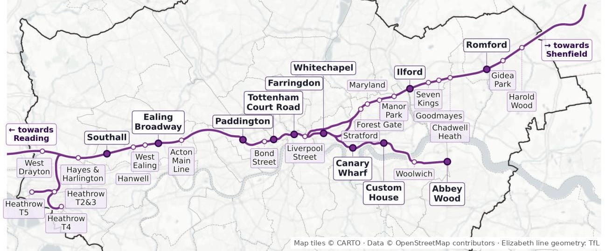
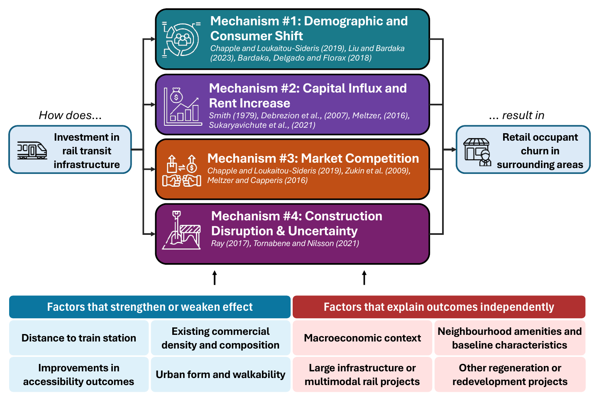
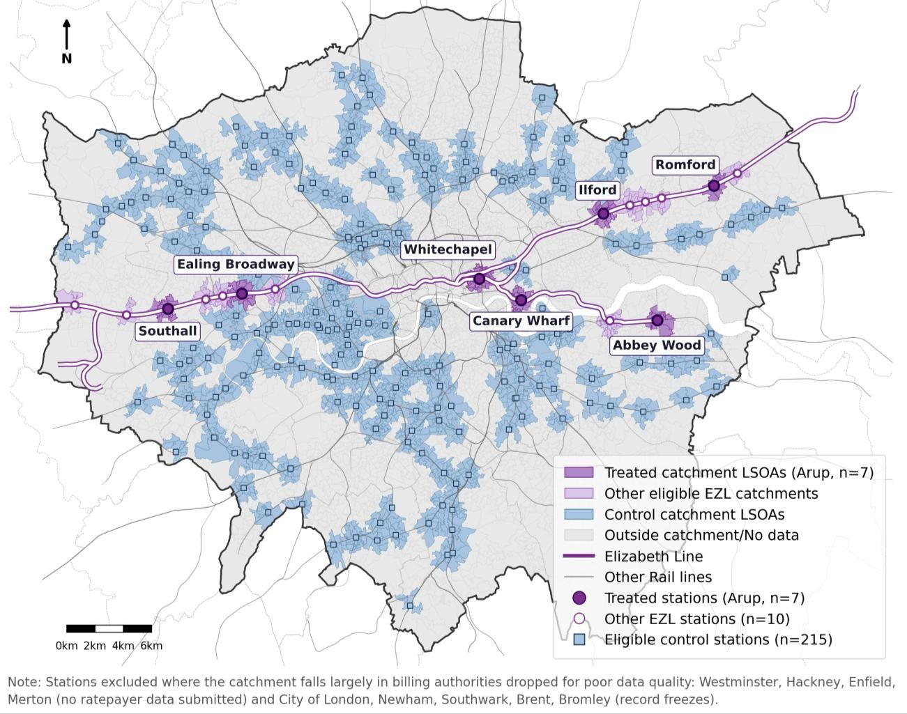
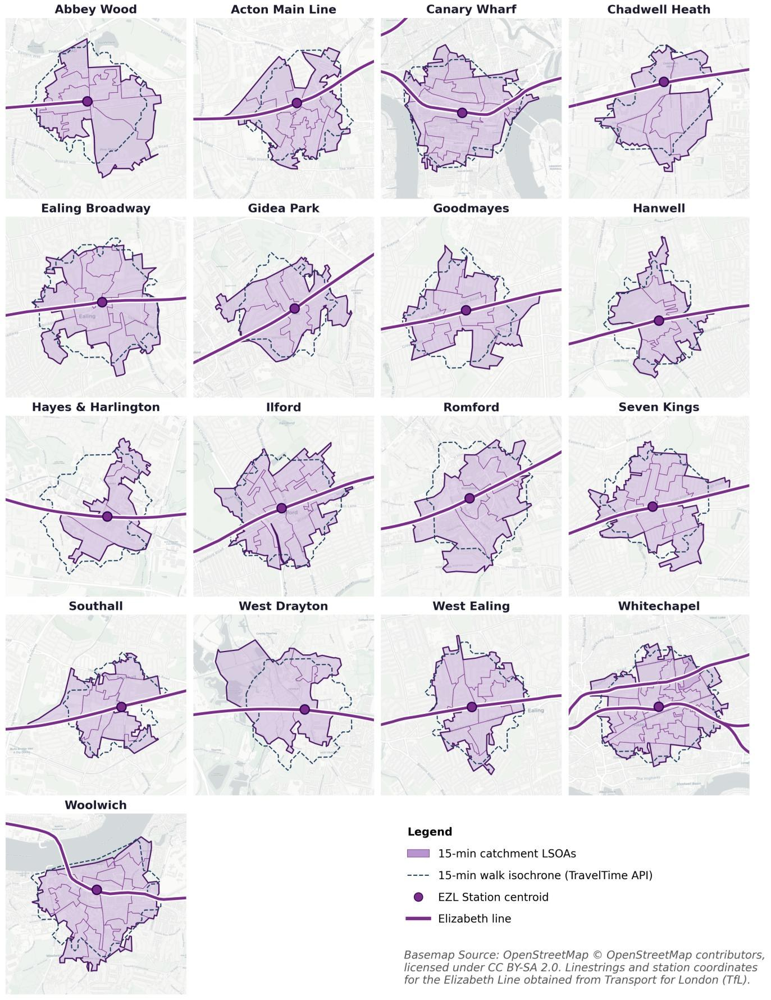
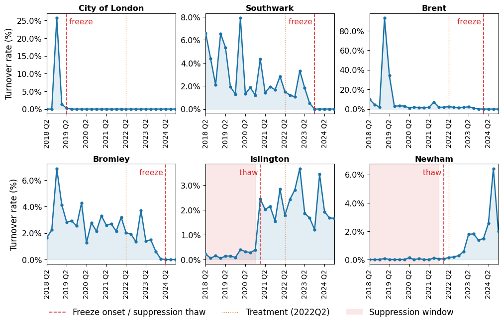
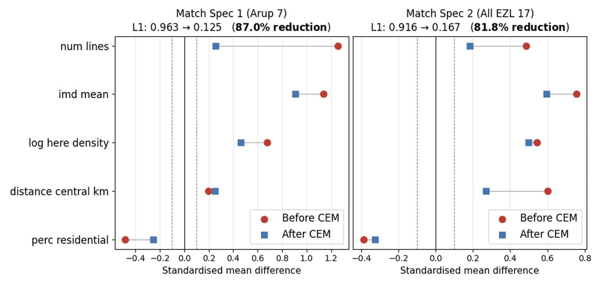

```{=html}
<style>
/* Page-local components. Neutral rgba borders read in both the light and dark themes. */
.ezl-steps, .ezl-tiles { display: grid; gap: 0.9rem; margin: 1.25rem 0 1.5rem; }
.ezl-steps { grid-template-columns: repeat(3, minmax(0, 1fr)); }
.ezl-tiles { grid-template-columns: repeat(4, minmax(0, 1fr)); }
@media (max-width: 767px) { .ezl-tiles { grid-template-columns: repeat(2, minmax(0, 1fr)); } }
@media (max-width: 767px) { .ezl-steps { grid-template-columns: 1fr; } }
.ezl-step, .ezl-tile {
  border: 1px solid rgba(127, 127, 127, 0.28);
  border-radius: 10px;
  padding: 0.9rem 1rem;
}
.ezl-step { border-top: 3px solid #7b2d8b; }
.ezl-step p { margin-bottom: 0.4rem; font-size: 0.94rem; }
.ezl-step-num {
  display: inline-block; font-size: 0.72rem; font-weight: 700;
  letter-spacing: 0.06em; text-transform: uppercase; color: #7b2d8b;
}
body.quarto-dark .ezl-step-num { color: #c59bd0; }
.ezl-tile .v { font-size: 1.6rem; font-weight: 700; line-height: 1.15; }
.ezl-tile .l { font-size: 0.84rem; opacity: 0.75; margin-top: 0.3rem; line-height: 1.3; }
.ezl-read-more { margin: 0.5rem 0 0.25rem; }
.ezl-scroll { overflow-x: auto; -webkit-overflow-scrolling: touch; }
</style>
```

::: {.callout-note appearance="simple" icon="false"}
This article summarises my MSc Urban Spatial Science dissertation at [The Bartlett Centre for Advanced Spatial Analysis (CASA)](https://www.ucl.ac.uk/bartlett/casa), UCL, which was supervised by Dr Jens Kandt.

**[TLDR.]{.underline}** A difference-in-differences with coarsened exact matching found **no statistically significant short-run effect of the Elizabeth line's May 2022 opening on retail occupant churn near its stations**. The null holds across eight specifications and two treatment definitions, and rules out moderate-to-large effects. Valuation Office Agency (VOA) ratepayer data provides an opportunity for such evaluations, but requires heavy cleaning, and may be better suited to corridor-specific studies.

[Read the full dissertation here (PDF) <i class="bi bi-box-arrow-up-right"></i>](Tee_2026_Elizabeth_line_business_churn.pdf){.btn .btn-primary .btn-sm .ezl-read-more target="_blank"}
:::

```{python}
#| label: setup
#| echo: false
#| output: false
## Shared imports, colours and layout for every chart on this page.
## All values below are transcribed from tables in the dissertation (table/annex noted per chunk).
import pandas as pd
import plotly.graph_objects as go
from plotly.subplots import make_subplots
from plotly.offline import get_plotlyjs_version
from IPython.display import HTML, display

TREATED, CONTROL = "#7b2d8b", "#eb6834"   # Elizabeth line purple (as in the maps) vs controls
INK, MUTED, FAINT, GRID = "#22262b", "#6b7681", "#b9bec4", "#eceef0"
FONT = '-apple-system, "Segoe UI", Roboto, "Helvetica Neue", Arial, sans-serif'
CONFIG = {"displayModeBar": False, "responsive": True}
SPECS = {"MS1": "Arup 7 (MS1)", "MS2": "All EZL 17 (MS2)"}


def tidy(fig, height, **layout):
    """Apply the site's typography and a quiet grid; keyword args override the defaults."""
    base = dict(
        height=height,
        font=dict(family=FONT, size=13, color=INK),
        paper_bgcolor="white", plot_bgcolor="white",
        hoverlabel=dict(bgcolor="white", bordercolor=FAINT, font=dict(family=FONT, color=INK)),
        margin=dict(l=10, r=20, t=60, b=10),
    )
    fig.update_layout(**{**base, **layout})
    fig.update_xaxes(gridcolor=GRID, linecolor=FAINT, zeroline=False, ticks="")
    fig.update_yaxes(gridcolor=GRID, linecolor=FAINT, zeroline=False, ticks="")
    fig.update_annotations(font=dict(family=FONT, color=INK))
    return fig


_PLOTLYJS_LOADED = False


def show(fig, min_width=None):
    """Embed a chart as plain HTML, so each chunk yields exactly one output (one figure number).
    `min_width` (px) keeps multi-panel charts legible on phones by letting them scroll sideways.
    plotly.js loads once, with the first chart, at the version matching the installed plotly.
    `define` is hidden while it loads so the bundle sets window.Plotly even when Quarto has
    added require.js to the page."""
    global _PLOTLYJS_LOADED
    html = fig.to_html(full_html=False, include_plotlyjs=False, config=CONFIG)
    if not _PLOTLYJS_LOADED:
        src = f"https://cdn.plot.ly/plotly-{get_plotlyjs_version()}.min.js"
        html = ('<script>window.PlotlyConfig = {MathJaxConfig: "local"};'
                'window.__amdDefine = window.define; window.define = undefined;</script>'
                f'<script charset="utf-8" src="{src}"></script>'
                '<script>window.define = window.__amdDefine;</script>' + html)
        _PLOTLYJS_LOADED = True
    if min_width:
        html = f'<div class="ezl-scroll"><div style="min-width:{min_width}px">{html}</div></div>'
    display(HTML(html))


def signed(x, nd=2):
    """Format a number with an explicit sign and a true minus."""
    return f"{x:+.{nd}f}".replace("-", "−")
```

## 1. Introduction

In May 2022, after more than a decade of construction and around £19 billion of investment [@benson_future_2024], the Elizabeth line's central tunnelled section opened beneath London, joining Reading and Heathrow in the west to Abbey Wood and Shenfield in the east. Across 41 stations (10 new stations), the line now carries around 200 million passenger journeys a year and has cut journey times on some corridors by more than 40% [@lee_connecting_2026]. More than 125,000 new jobs were registered within a kilometre of its stations between 2022 and 2023 [@tfl_new_2025].

{fig-alt="Elizabeth line route and stations within central London."}

Official evaluations have documented gains in jobs, journey times and property values [@arup_elizabeth_2025]. However, much less is known about the impact of the new line on retail tenants around its stations, specifically whether the shops, cafés and services near each station are being displaced and replaced, and if so by who, and how fast.

The literature on this topic is broad, and offers no definitive answers. However, we discern four channels through which a new rail line could affect retail occupant churn (@fig-mechanisms):

- **Demographic and consumer shift.** A wider catchment and higher-spending residents could lift revenue for some incumbents but push out those that cannot adapt to "retail upscaling" [@chapple_commercial_2019].
- **Capital influx and rent increase.** Landlords seeking to capture the accessibility premium could raise rents, which could price out tenants whose revenue lags, although lease renewal cycles could delay the effect [@meltzer_gentrification_2016].
- **Market competition.** Footfall increase could draw in new entrants, especially well-capitalised chains that can outbid independents [@liu_transit_2023].
- **Construction disruption.** Years of construction work and disamenities can significantly reduce access and visibility. In Los Angeles, station construction raised closure risk by 46% within 400 metres [@ray_open_2017].

{#fig-mechanisms fig-alt="Diagram: investment in rail transit infrastructure feeds four mechanisms (demographic and consumer shift, capital influx and rent increase, market competition, construction disruption and uncertainty) that result in retail occupant churn. Moderators listed below include distance to station, commercial density, accessibility improvements and urban form; confounders include macroeconomic context, neighbourhood characteristics, other infrastructure and regeneration projects."}

These forces pull in different directions, and empirical evidence reflects it, ranging from systematic displacement [@lin_proximity_2019] to null effects [@liu_transit_2023] to improved business survival [@liu_exploring_2025]. While most studies on this topic have focused on North American light rail examples, where business microdata is easier to obtain [@bardaka_transit_2024], UK commuter rail is comparatively unstudied.

Two aspects of London's evolving context enables further investigation of this topic. First, the end-to-end opening of the Elizabeth line presents a discrete, spatially targeted improvement in accessibility, well-suited to a quasi-experiment approach. Second, with advancements in Artificial Intelligence (AI), new methods to reconcile Valuation Office Agency (VOA) rating lists and council ratepayer records have been developed [@whythawk_openlocal_2026], enabling research into occupier change events. 

## 2. Research questions

This study asks two questions:

> **RQ1.** Did the end-to-end opening of the Elizabeth line in May 2022 accelerate retail occupant churn within station catchments, relative to comparable, unserved control catchments?
>
> **RQ2.** What are the strengths and limitations of administrative ratepayer data as a panel source for evaluating retail churn, and under what conditions can it support credible causal inference?

In answering these questions, this study makes two contributions. First, it advances knowledge on the retail impact of a major commuter-rail investment in the UK. Second, it evaluates the utility and constraints of a novel, establishment-level administrative dataset for urban policy research. 

## 3. Research design

Did the Elizabeth line change how quickly businesses churn around its stations? To answer this, we need to estimate something we *cannot directly observe*: how those neighbourhoods would have changed, *if the line had not opened*. 

Simply comparing Elizabeth line station areas with the rest of London would be misleading, as the areas served are **not random nor typical London neighbourhoods**. They differ in density, deprivation, access and economic activity, which independently affect how fast businesses churn. It would also not be accurate to simply compare these areas before and after the line opened in May 2022, as **pre- and post- opening trends differ given the extent of pandemic recovery, e-commerce growth and economic changes**. 

Instead, this analysis uses a method called *difference-in-differences*. The principle is straightforward: measure how business churn changed around Elizabeth line stations, measure how it changed in the same period in comparable areas without the line, and compute the difference between the two rates.

This comparison helps separate the line's potential effect from the differences between neighbourhoods, and changes affecting London as a whole. However, it depends on an important assumption that without the Elizabeth line, business chun in the two groups would have followed similar trends. Researchers call this *parallel trends*. It cannot be observed directly, so the research design uses three steps to make the assumption more credible [@huntington-klein_effect_2021; @graham_causal_2025].

:::: {.ezl-steps}
::: {.ezl-step}
[Step 1]{.ezl-step-num}

**Define credible treatment and controls**

Treated group comprises small neighbourhoods or Lower Super Output Areas (LSOAs) within a 15-minute walk of Elizabeth line stations (treated). Control group comprises similar catchments around other Tube and National Rail stations, excluding areas that overlap with the Elizabeth line.
:::

::: {.ezl-step}
[Step 2]{.ezl-step-num}

**Match neighbourhoods with similar starting characteristics**

Even among station areas, neighbourhoods can differ substantially. This analysis uses coarsened exact matching to retain comparison areas that fall into the same categories as treated areas across five characteristics.
:::

::: {.ezl-step}
[Step 3]{.ezl-step-num}

**Separating causal effect from wider changes**

Comparing changes in business turnover between the matched groups before and after May 2022 gives an estimated causal effect. Neighbourhood and quarter fixed effects account for persistent differences between places and changes common across London over time. An event study supplements this, capturing how the two groups' trends evolved prior to opening. 
:::
::::

### Step 1: Define credible treatment and controls

Station catchments were defined using 15-minute walking isochrones generated through the TravelTime API. Unlike fixed-radius circles, isochrones map the areas reachable on foot within a given time, accounting for the street network and available walking routes. This provides a consistent, realistic measure of station access.

Two treatment groups were constructed to test whether the findings depend on which Elizabeth line stations are included:

- **Arup 7 (MS1)**: Arup’s post-opening evaluation identified 11 Greater London stations as representative case studies [@arup_elizabeth_2025]. Four were excluded because their boroughs lacked usable ratepayer data, leaving seven stations: Abbey Wood, Canary Wharf, Ealing Broadway, Ilford, Romford, Southall and Whitechapel.
- **All EZL 17 (MS2)**: a broader group covering 17 Elizabeth line stations in Greater London, after excluding stations with incomplete data, the three Heathrow stations, and Harold Wood because it had too few businesses for reliable analysis.

The treatment date was taken to be **24 May 2022**, when the Elizabeth line began through-running across central London. Earlier TfL Rail services were treated as incremental improvements rather than the main intervention.

The control group was designed to represent what might have happened to business turnover around the treated stations had the Elizabeth line not opened. Starting with *589 Underground and National Rail stations*, the analysis excluded Elizabeth line stations and overlapping catchments, stations served only by other transport modes or unsuitable parts of the Overground network, and areas affected by major developments or transport schemes that could independently change business activity. Small stations, stations outside Greater London and stations without adequate data were also removed. *215 eligible control stations* (@fig-catchments) were left after screening, providing a credible comparison basket.

{#fig-catchments fig-alt="Map of Greater London showing the Elizabeth line, seven Arup treated stations with their catchments in purple, ten other Elizabeth line catchments in light purple, and 215 eligible control station catchments in blue."}

::: {.callout-note collapse="true" appearance="simple"}
## Show the 15-minute walking catchments of all 17 treated stations
{fig-alt="Small-multiple maps of the 17 treated Elizabeth line stations, each showing its 15-minute walking isochrone and the LSOAs whose centroids fall inside it."}
:::

### Step 2: Match neighbourhoods with similar starting characteristics

Elizabeth line stations tend to serve denser, more deprived and better-connected areas than the typical London station. If these differences are not accounted for, the analysis could mistake existing differences between neighbourhoods for an effect. 

To reduce this risk, coarsened exact matching (CEM) was used to group eligible stations into categories based on their pre-opening characteristics. Only treated and control stations that fall into the same category combination were retained [@iacus_causal_2012]. Rather than comparing every Elizabeth line station with every control, it compares stations with similar starting conditions. 

Five covariates were used: **distance to central London**, **number of rail lines**, **log hereditament density**, **mean deprivation (IMD)** and **share of residential land**. Every treated station retains all eligible control stations in its matching cell. CEM weights are then applied so that cells containing many controls do not disproportionately influence results. While matching cannot guarantee that treated and control stations would have followed identical trends in the absence of the Elizabeth line, it reduces observable differences between the groups, making the comparison more credible.

### Step 3: Separating causal effect from wider changes

With the identification of comparable treatment and control stations, the analysis compares business turnover in their neighbourhoods before and after the Elizabeth line opened. Turnover is aggregated to small neighbourhoods (LSOAs) by quarter, and a two-way fixed-effects model estimates the difference between the changes in treated and control areas.

$$
Y_{it} = \alpha + \beta\,(D_i \times T_t) + \mu_i + \gamma_t + \varepsilon_{it}
$$

where $Y_{it}$ is the turnover rate in LSOA $i$ in quarter $t$, $D_i$ flags treated catchments, $T_t$ flags quarters from 2022Q2, and $\mu_i$ and $\gamma_t$ are LSOA and quarter fixed effects. 

The coefficient of interest, $\beta$ measures the estimated effect of the Elizabeth line, expressed in percentage points of the turnover rate. Observations are weighted by matching weights from Step 2, so the estimates reflect the intended weighting of neighbourhoods and matched comparisons. Standard errors are clustered by station to account for the possibility that observations associated with the same station are not statistically independent.

Three extensions test how robust the findings are.

- **Adjusting for different trends**: A doubly robust specification adds interactions between the post-opening period and the five matching characteristics. This allows the relationship between those characteristics and turnover to change after the opening, reducing the risk that the estimated effect reflects these changing relationships rather than the line itself [@ho_matching_2007].
- **Accounting for spatial correlation**: Neighbouring catchments may experience related economic changes, so their estimation errors may be correlated. Conley standard errors, using a 2 km spatial cutoff, account for this possibility [@conley_gmm_1999].
- **Examining the timing of the effect**: A binned event study estimates the pattern of effects across the ten quarters before and after the opening, relative to a reference quarter. Pre-opening estimates help assess whether treated and control areas were already following different trends, while post-opening estimates show when any changes emerged. The analysis can also reveal possible anticipation effects if differences appear before the official opening date [@schmidheiny_event_2023].

## 4. Data 

Estimating the impact of the Elizabeth line opening on surrounding retail activity requires high-resolution spatial data. This study draws on a novel dataset, OpenLocal (https://openlocal.uk/), compiled from Valuation Office Agency (VOA) ratepayer records.

[OpenLocal](https://openlocal.uk/) links VOA property attributes (rateable value, floor area, use) with council billing data (account name, occupancy) for each *hereditament*, a unit of non-domestic property with its own Unique Address Reference Number (UARN). A turnover event is recorded when a unit's account name changes between consecutive quarters, or when a named occupier gives way to a vacant record. The panel covers retail-facing uses, from shops and food outlets to hotels and indoor leisure, from 2018 to 2024.

OpenLocal offers good spatial and sectoral granularity, providing quarterly observations tracked by unique property identifiers. However, overall data quality is mixed due to differences in reporting practices. 

```{=html}
<div class="ezl-tiles">
  <div class="ezl-tile"><div class="v">23/33</div><div class="l">London billing authorities retained</div></div>
  <div class="ezl-tile"><div class="v">2.01M</div><div class="l">hereditament-quarter observations, 2018Q1–2024Q4</div></div>
  <div class="ezl-tile"><div class="v">31,757</div><div class="l">turnover events across 1.25M eligible quarter-to-quarter pairs</div></div>
  <div class="ezl-tile"><div class="v">2.53%</div><div class="l">average quarterly turnover rate</div></div>
</div>
```

Ultimately, ratepayer lists are built for tax administration, and there are limits in detecting an occupier change event. The cleaning pipeline successfully removes near-identical names, VOA placeholders, rebrands, landlord-to-landlord exchanges and individual proprietors. 

Notwitstanding, four limitations remain:

1. **Masking and frozen records.** Ten of London's 33 billing authorities were dropped. Westminster, Hackney, Merton and Enfield mask ratepayer names; City of London, Southwark, Brent, Bromley, Islington and Newham have long frozen or suppressed runs (@fig-freezes). These losses limit the extent of analysis within central London. 
2. **Revaluation breaks.** The April 2023 revaluation (taken periodically by VOA) retired and reassigned UARNs, so units absent from every later quarter were dropped rather than misread as closures.
3. **Administrative spikes.** Seven borough-quarters in Harrow, Greenwich, Hammersmith & Fulham and Tower Hamlets recored turnover above 10 percentage points. These 24,082 observations are kept in baseline models and removed in "artefact-excluded" ones.
4. **Timing.** The data record when a change is filed, not when a business leaves. This results in some lead and lag effects between actual churn and recorded events.

{#fig-freezes fig-alt="Six small line charts of quarterly turnover rate from 2018 to 2024 for City of London, Southwark, Brent, Bromley, Islington and Newham. City of London, Southwark, Brent and Bromley drop to zero after a freeze date; Islington and Newham show near-zero turnover during long suppression windows before recovering."}

## 5. Key findings

### 5.1 Coarsened Exact Matching - effective in reducing covariate imbalance

CEM matched 6 of 7 stations in MS1 and 14 of 17 in MS2 (@tbl-cem). Abbey Wood was unmatched in both samples, as its hereditament density was lower than at any of the 215 control stations; West Drayton and West Ealing also went unmatched in MS2. Overall, **matching reduced multivariate (L1) imbalance by 87.0% and 81.8%**.

::: {.callout-note collapse="true" appearance="simple"}
## Show how CEM reduced overall multivariate (L1) imbalance
{fig-alt="Covariate balance before and after CEM (Love plot)."}
:::

| | Arup 7 (MS1) | All EZL 17 (MS2) |
|:--|:--|:--|
| Treated stations matched | 6 of 7 (85.7%) | 14 of 17 (82.4%) |
| Unmatched | Abbey Wood | Abbey Wood, West Drayton, West Ealing |
| Control stations used | 8 of 215 (3.7%) | 18 of 215 (8.4%) |
| L1 imbalance, before → after | 0.927 → 0.125 (−87.0%) | 0.916 → 0.167 (−81.8%) |
| Matched LSOAs, treated / control | 73 / 101 | 130 / 161 |
| LSOA-quarter observations | 4,670 | 7,699 |

: Coarsened exact matching outcomes {#tbl-cem}

@fig-cem shows the matches. Canary Wharf and Whitechapel are matched with Goldhawk Road, West Brompton and West Hampstead; Ilford pairs with East Croydon; Romford and Hayes & Harlington with Uxbridge. Matches are close on centrality and connectivity, but treated stations tend to be more deprived than their controls (e.g. Whitechapel's IMD is 39.5, West Hampstead's 22.7). Hence, a doubly robust specification was therefore used to isolate remaining differences.

```{python}
#| label: fig-cem
#| echo: false
#| warning: false
#| fig-cap: "Covariates of each matched Elizabeth line station (purple) and its CEM-matched control stations (orange), All EZL 17 specification. Stations in bold also form the Arup 7 set (MS1), where their matches are identical. Rows run from most central to most outer. Hover for station names."

## Annex C: pre-opening covariates of matched stations.
## (distance to centre km, rail lines, log hereditament density, mean IMD, residential share)
STATIONS = {
    "Acton Main Line": (9.849, 1, 4.493, 26.41, 0.630),
    "Canary Wharf": (7.467, 2, 5.594, 32.30, 0.725),
    "Chadwell Heath": (18.902, 1, 5.249, 32.46, 0.864),
    "Ealing Broadway": (12.196, 3, 4.899, 17.19, 0.813),
    "Gidea Park": (24.479, 1, 4.036, 9.61, 0.890),
    "Goodmayes": (17.689, 1, 5.123, 26.00, 0.866),
    "Hanwell": (14.747, 1, 4.907, 20.85, 0.774),
    "Hayes & Harlington": (20.411, 2, 5.215, 27.58, 0.569),
    "Ilford": (14.711, 1, 5.635, 32.17, 0.823),
    "Romford": (22.686, 2, 5.476, 24.25, 0.763),
    "Seven Kings": (16.669, 1, 4.928, 24.35, 0.881),
    "Southall": (17.479, 2, 5.873, 36.28, 0.698),
    "Whitechapel": (4.780, 3, 6.057, 39.46, 0.520),
    "Woolwich": (13.878, 1, 5.132, 30.69, 0.764),
    # controls
    "Burnt Oak": (14.262, 1, 4.510, 28.48, 0.837),
    "Crofton Park": (8.534, 1, 4.431, 22.66, 0.827),
    "East Croydon": (14.892, 1, 5.713, 26.08, 0.750),
    "Goldhawk Road": (7.009, 2, 5.964, 25.52, 0.712),
    "Gunnersbury": (10.505, 2, 4.738, 14.35, 0.831),
    "Hatch End": (20.268, 1, 3.733, 7.95, 0.863),
    "Hounslow Central": (17.164, 1, 4.965, 23.51, 0.801),
    "Hounslow East": (16.440, 1, 5.073, 21.61, 0.807),
    "Kew Bridge": (11.362, 1, 4.205, 24.04, 0.675),
    "Maze Hill": (9.381, 2, 4.870, 17.93, 0.780),
    "Northwood": (23.633, 1, 3.742, 8.58, 0.936),
    "Selhurst": (13.144, 1, 4.854, 37.08, 0.738),
    "South Croydon": (16.260, 1, 4.897, 22.91, 0.886),
    "South Harrow": (16.905, 1, 4.561, 20.62, 0.840),
    "Uxbridge": (24.769, 2, 4.676, 21.24, 0.645),
    "West Brompton": (5.338, 3, 5.672, 24.98, 0.818),
    "West Croydon": (14.473, 2, 5.811, 35.93, 0.635),
    "West Hampstead": (6.271, 2, 5.552, 22.69, 0.810),
}
## Tables 8-9: matched controls per treated station (MS2; MS1 = the Arup subset, same matches).
MATCHES = {
    "Acton Main Line": ["Crofton Park", "Kew Bridge"],
    "Canary Wharf": ["Goldhawk Road", "West Brompton", "West Hampstead"],
    "Chadwell Heath": ["Burnt Oak", "South Croydon", "South Harrow"],
    "Ealing Broadway": ["Gunnersbury", "Maze Hill"],
    "Gidea Park": ["Hatch End", "Northwood"],
    "Goodmayes": ["Burnt Oak", "South Croydon", "South Harrow"],
    "Hanwell": ["Hounslow Central", "Hounslow East", "Selhurst"],
    "Hayes & Harlington": ["Uxbridge"],
    "Ilford": ["East Croydon"],
    "Romford": ["Uxbridge"],
    "Seven Kings": ["Burnt Oak", "South Croydon", "South Harrow"],
    "Southall": ["West Croydon"],
    "Whitechapel": ["Goldhawk Road", "West Brompton", "West Hampstead"],
    "Woolwich": ["Hounslow Central", "Hounslow East", "Selhurst"],
}
ARUP = {"Canary Wharf", "Ealing Broadway", "Ilford", "Romford", "Southall", "Whitechapel"}
COVARIATES = [  # (title, scale applied to the raw value, hover format)
    ("Distance to<br>centre (km)", 1, "{:.1f} km"),
    ("Rail<br>lines", 1, "{:.0f}"),
    ("Hereditament<br>density (log)", 1, "{:.2f}"),
    ("Deprivation<br>(mean IMD)", 1, "{:.1f}"),
    ("Residential<br>land (%)", 100, "{:.0f}%"),
]

order = sorted(MATCHES, key=lambda s: STATIONS[s][0])   # most central first
row = {s: i for i, s in enumerate(order)}
OFFSET = 0.17                                           # treated just above, controls just below

fig = make_subplots(rows=1, cols=len(COVARIATES), shared_yaxes=True,
                    horizontal_spacing=0.025, subplot_titles=[c[0] for c in COVARIATES])

for j, (title, scale, fmt) in enumerate(COVARIATES, start=1):
    # Controls: merge identical values in a row into one marker so hover lists every station.
    pts = {}
    for t, ctrls in MATCHES.items():
        for c in ctrls:
            v = STATIONS[c][j - 1] * scale
            pts.setdefault((t, v), []).append(c)
    fig.add_trace(go.Scatter(
        x=[v for (_, v) in pts], y=[row[t] + OFFSET for (t, _) in pts],
        mode="markers", name="Matched control station(s)", legendgroup="c", showlegend=(j == 1),
        marker=dict(color=CONTROL, size=9, line=dict(color="white", width=1.5)),
        hovertemplate="%{text}<extra></extra>",
        text=[f"<b>{', '.join(names)}</b><br>Control for {t}<br>{title.replace('<br>', ' ')}: {fmt.format(v)}"
              for (t, v), names in pts.items()],
    ), row=1, col=j)
    fig.add_trace(go.Scatter(
        x=[STATIONS[t][j - 1] * scale for t in order], y=[row[t] - OFFSET for t in order],
        mode="markers", name="Elizabeth line station (treated)", legendgroup="t", showlegend=(j == 1),
        marker=dict(color=TREATED, size=11, line=dict(color="white", width=1.5)),
        hovertemplate="%{text}<extra></extra>",
        text=[f"<b>{t}</b> (treated)<br>{title.replace('<br>', ' ')}: {fmt.format(STATIONS[t][j - 1] * scale)}"
              for t in order],
    ), row=1, col=j)

fig.update_yaxes(tickvals=list(range(len(order))),
                 ticktext=[f"<b>{s}</b>" if s in ARUP else s for s in order],
                 autorange="reversed", showgrid=True)
fig.update_xaxes(row=1, col=2, dtick=1, range=[0.5, 3.5])
tidy(fig, 660, legend=dict(orientation="h", x=0, y=-0.05, xanchor="left", yanchor="top",
                           traceorder="reversed"),
     margin=dict(l=10, r=10, t=56, b=40), hovermode="closest")
fig.update_annotations(font_size=12)
show(fig, min_width=590)
```

### 5.2 Difference-in-differences regression: no clear evidence of increased churn

Quarterly business turnover rose from 2.64% to 2.94% in treated catchments after the Elizabeth line opened, while falling slightly from 3.31% to 3.26% in controls. The resulting raw difference-in-differences suggests an increase of +0.35 percentage points in MS1 and +0.49 in MS2 (@fig-simple-did).

```{python}
#| label: fig-simple-did
#| echo: false
#| warning: false
#| fig-cap: "Average quarterly turnover rate before and after the opening. The dotted line is the treated group's path had it followed the controls' change; the gap at the end is the simple difference-in-differences."

# Table 10: matched-panel turnover rate (%), pre vs post treatment.
RATES = {"MS1": {"Treated": (2.64, 2.94), "Control": (3.31, 3.26)},
         "MS2": {"Treated": (2.51, 2.79), "Control": (3.28, 3.07)}}

fig = make_subplots(rows=1, cols=2, shared_yaxes=True, horizontal_spacing=0.08,
                    subplot_titles=list(SPECS.values()))
for j, (spec, r) in enumerate(RATES.items(), start=1):
    (t0, t1), (c0, c1) = r["Treated"], r["Control"]
    # counterfactual: treated pre + control change
    cf = t0 + (c1 - c0)
    for name, ys, colour, dash, width in [
        ("Elizabeth line catchments", (t0, t1), TREATED, "solid", 2.5),
        ("Matched controls", (c0, c1), CONTROL, "solid", 2.5),
        ("Elizabeth line, had it followed controls", (t0, cf), TREATED, "dot", 2),
    ]:
        fig.add_trace(go.Scatter(
            x=[0, 1], y=ys, mode="lines+markers", name=name, legendgroup=name, showlegend=(j == 1),
            line=dict(color=colour, width=width, dash=dash),
            marker=dict(size=9 if dash == "solid" else 6, color=colour,
                        line=dict(color="white", width=1.5)),
            hovertemplate=f"{name}<br>%{{y:.2f}}%<extra></extra>",
        ), row=1, col=j)
    # Bracket the simple DID between the counterfactual and the actual treated value.
    ax = "" if j == 1 else j                   # plotly axis ids: x, x2, ...
    fig.add_shape(type="line", x0=1.06, x1=1.06, y0=cf, y1=t1, xref=f"x{ax}", yref=f"y{ax}",
                  line=dict(color=INK, width=1.5))
    fig.add_annotation(x=1.08, y=(cf + t1) / 2, xref=f"x{ax}", yref=f"y{ax}", xanchor="left",
                       showarrow=False, text=f"<b>{signed(t1 - cf)} pp</b><br>simple DID",
                       align="left", font=dict(size=12))
fig.update_xaxes(tickvals=[0, 1], ticktext=["Before opening", "After opening"],
                 range=[-0.15, 1.45], showgrid=False)
fig.update_yaxes(title_text="Quarterly turnover rate (%)", row=1, col=1)
fig.update_yaxes(range=[2.1, 3.5], tickformat=".1f", ticksuffix="%")
tidy(fig, 420, legend=dict(orientation="h", x=0, y=-0.12, xanchor="left", yanchor="top"),
     margin=dict(l=10, r=10, t=40, b=40))
show(fig, min_width=500)
```

But this raw difference does not account fully for other factors that may have influenced turnover. Regression-based difference-in-differences adjusts for persistent differences between neighbourhoods and wider quarterly shocks, while the preferred specification excludes administrative artefacts and allows for post-opening trends in the matching covariates.

After adjustment, the **estimated effects are smaller and statistically indistinguishable from zero** (@fig-did). The preferred estimate is **+0.20 percentage points for MS1** (95% CI −0.32 to +0.73; p = 0.42) and **+0.13 percentage points for MS2** (95% CI −0.26 to +0.51; p = 0.50). Relative to a baseline of about 2.5% per quarter, these estimates provide reasonably precise evidence against moderate-to-large effects..

Only one of eight model estimates is statistically significant: the MS2 doubly robust specification retaining administrative artefacts (+0.45 percentage points, p = 0.047). Its significance disappears when administrative spikes are removed, suggesting sensitivity to these observations rather than robust evidence of an effect. Conley standard errors accounting for spatial correlation do not change the overall inference (hover over estimates in Figure @fig-did for details).

```{python}
#| label: fig-did
#| echo: false
#| warning: false
#| fig-cap: "Estimated effect of the Elizabeth line opening on quarterly turnover rate across eight two-way fixed effects specifications, with 95% confidence intervals clustered by station. Preferred specification is in purple."

## Table 11 (station-clustered SEs) and Annex E (Conley 2 km p-values).
DID = pd.DataFrame(
    [  # spec, model, beta, se, p, ci_lo, ci_hi, n_obs, clusters, conley_p
        ("MS1", 1, 0.238, 0.322, 0.473, -0.458, 0.934, 4670, 14, 0.439),
        ("MS1", 2, 0.526, 0.339, 0.145, -0.207, 1.260, 4670, 14, 0.110),
        ("MS1", 3, -0.231, 0.273, 0.412, -0.821, 0.359, 4597, 14, 0.361),
        ("MS1", 4, 0.203, 0.244, 0.420, -0.324, 0.730, 4597, 14, 0.394),
        ("MS2", 1, 0.374, 0.271, 0.177, -0.178, 0.927, 7699, 32, 0.187),
        ("MS2", 2, 0.449, 0.216, 0.047, 0.007, 0.890, 7699, 32, 0.043),
        ("MS2", 3, -0.034, 0.249, 0.839, -0.542, 0.474, 7575, 32, 0.896),
        ("MS2", 4, 0.129, 0.189, 0.499, -0.256, 0.514, 7575, 32, 0.505),
    ],
    columns=["spec", "model", "beta", "se", "p", "lo", "hi", "n", "clusters", "conley_p"],
)
MODELS = {1: "(1) Base<br>incl. artefacts", 2: "(2) Doubly robust<br>incl. artefacts",
          3: "(3) Base<br>excl. artefacts", 4: "<b>(4) Doubly robust<br>excl. artefacts</b>"}
PREFERRED = 4

fig = make_subplots(rows=1, cols=2, shared_yaxes=True, horizontal_spacing=0.04,
                    subplot_titles=list(SPECS.values()))
for j, spec in enumerate(SPECS, start=1):
    d = DID[DID.spec == spec]
    for preferred, colour in [(False, MUTED), (True, TREATED)]:
        s = d[(d.model == PREFERRED) == preferred]
        fig.add_trace(go.Scatter(
            x=s.beta, y=s.model.map(MODELS), mode="markers", showlegend=False,
            marker=dict(color=colour, size=11, line=dict(color="white", width=1.5)),
            error_x=dict(type="data", symmetric=False, array=s.hi - s.beta,
                         arrayminus=s.beta - s.lo, color=colour, thickness=2, width=0),
            hovertemplate="%{text}<extra></extra>",
            text=[f"<b>{MODELS[m].replace('<b>', '').replace('</b>', '').replace('<br>', ', ')}</b><br>"
                  f"β = {signed(b, 3)} pp (SE {se:.3f})<br>95% CI {signed(lo, 3)} to {signed(hi, 3)}<br>"
                  f"p = {p:.3f} · Conley (2 km) p = {cp:.3f}<br>{n:,} LSOA-quarters · {g} clusters"
                  for m, b, se, lo, hi, p, cp, n, g in
                  zip(s.model, s.beta, s.se, s.lo, s.hi, s.p, s.conley_p, s.n, s.clusters)],
        ), row=1, col=j)
    fig.add_vline(x=0, line=dict(color=INK, width=1), row=1, col=j)

sig = DID[(DID.spec == "MS2") & (DID.model == 2)].iloc[0]
fig.add_annotation(x=sig.beta, y=MODELS[2], xref="x2", yref="y2", yanchor="bottom", yshift=9,
                   showarrow=False, text="p = 0.047", font=dict(size=12, color=MUTED))
fig.update_yaxes(categoryorder="array", categoryarray=[MODELS[m] for m in (4, 3, 2, 1)])
fig.update_xaxes(title_text="Effect on turnover rate (pp)", range=[-1, 1.4],
                 tickvals=[-1, -0.5, 0, 0.5, 1], zeroline=False)
tidy(fig, 400, margin=dict(l=10, r=20, t=40, b=10), hovermode="closest")
show(fig, min_width=540)
```

### 5.3 Event study: no clear post-opening pattern, but early warning on pre-trends

Event-study estimates fluctuate around zero after the May 2022 opening, with no sustained change in business churn or clear evidence of anticipation (@fig-event).

However, joint tests reject the null that all pre-opening coefficients are zero (MS1: χ² = 30.48, p = 0.0004; MS2: χ² = 27.73, p = 0.0011), raising concerns about the parallel-trends assumption despite no individually significant pre-opening estimates.

Sensitivity checks locate much of this signal in the three earliest pre-opening quarters (2019Q4–2020Q2). Leave-one-out diagnostics show that removing any one quarter reduces the joint-test statistic by 28–56%. After excluding these quarters, the tests no longer reject at 5% (MS1: χ² = 11.99, p = 0.062; MS2: χ² = 6.21, p = 0.400).

Thus, early quarters account for much of the pre-trend warning, and post-opening estimates remain broadly unchanged. Nevertheless, the initial joint-test results mean that parallel trends cannot be assumed without qualification.

```{python}
#| label: fig-event
#| echo: false
#| warning: false
#| fig-cap: "Top: event-study coefficients with 95% confidence intervals (station-clustered), relative to quarter before opening (q−1); the pre-trend test is a joint Wald test over q−10 to q−2, with endpoints binned. Bottom: share of test statistic removed when each lead is dropped. Use the buttons to toggle specifications."

# Annex F: event-study coefficients (pp) and SEs; Annex G: leave-one-out shares (%);
# Table 12: joint Wald tests over q-10..q-2.
EVENT = {  # q: (MS1 estimate, MS1 SE, MS1 p, MS2 estimate, MS2 SE, MS2 p)
    -10: (-0.162, 1.070, 0.882, -0.505, 0.824, 0.545),
    -9: (0.103, 0.947, 0.915, 0.029, 0.676, 0.966),
    -8: (1.729, 1.450, 0.254, 1.201, 1.146, 0.303),
    -7: (-0.569, 1.226, 0.650, -0.629, 0.909, 0.494),
    -6: (-0.784, 1.172, 0.515, -0.756, 0.837, 0.374),
    -5: (-1.005, 1.074, 0.366, -0.975, 0.871, 0.272),
    -4: (-0.760, 1.942, 0.702, -0.863, 1.332, 0.522),
    -3: (1.387, 1.244, 0.285, 0.758, 0.949, 0.431),
    -2: (-0.406, 1.259, 0.752, -0.590, 1.000, 0.559),
    0: (1.366, 1.358, 0.333, 0.798, 1.015, 0.438),
    1: (-0.538, 1.140, 0.645, -0.578, 0.846, 0.500),
    2: (-1.400, 1.002, 0.186, -1.039, 0.758, 0.180),
    3: (-1.101, 1.227, 0.386, -1.378, 1.153, 0.241),
    4: (0.011, 0.570, 0.985, 0.215, 0.609, 0.727),
    5: (0.683, 1.275, 0.601, 0.326, 1.025, 0.753),
    6: (-0.088, 1.104, 0.938, -0.263, 0.900, 0.772),
    7: (0.074, 1.013, 0.943, -0.243, 0.997, 0.809),
    8: (-1.553, 1.601, 0.350, -1.095, 1.272, 0.396),
    9: (-0.746, 1.101, 0.510, -0.495, 0.842, 0.561),
    10: (-0.107, 1.086, 0.923, -0.140, 0.804, 0.862),
}
LOO = {"MS1": [50, 28, 31, 5, 5, 6, 4, 10, 18], "MS2": [
    38, 33, 56, 0, 0, 1, 3, 12, 2]}  # leads -10..-2
WALD = {"MS1": (30.48, "0.0004"), "MS2": (27.73, "0.0011")}
# t(0.975, G-1) for G = 14 and 32 station clusters
TCRIT = {"MS1": 2.160, "MS2": 2.040}
LEADS, COVID = list(range(-10, -1)), (-10, -9, -8)


def calendar(q):
    """Relative quarter -> calendar quarter, with q0 = 2022Q2 (opening on 24 May 2022)."""
    i = 2022 * 4 + 1 + q
    return f"{i // 4}Q{i % 4 + 1}" + (" and earlier" if q == -10 else "")


def qlabel(q):
    return "≤−10" if q == -10 else ("0" if q == 0 else signed(q, 0))


fig = make_subplots(rows=2, cols=1, shared_xaxes=True, row_heights=[0.68, 0.32],
                    vertical_spacing=0.07)
for k, spec in enumerate(SPECS):
    on = k == 0                      # MS1 visible on load
    qs = [q for q in EVENT]
    est = [EVENT[q][3 * k] for q in qs]
    se = [EVENT[q][3 * k + 1] for q in qs]
    pv = [EVENT[q][3 * k + 2] for q in qs]
    half = [TCRIT[spec] * s for s in se]
    fig.add_trace(go.Scatter(
        x=qs, y=est, mode="markers", visible=on, showlegend=False,
        marker=dict(color=TREATED, size=9, line=dict(
            color="white", width=1.5)),
        error_y=dict(type="data", array=half,
                     color=TREATED, thickness=1.5, width=0),
        hovertemplate="%{text}<extra></extra>",
        text=[f"<b>q{qlabel(q)}</b> · {calendar(q)}<br>Estimate: {signed(e)} pp<br>"
              f"95% CI {signed(e - h)} to {signed(e + h)}<br>p = {p:.3f}"
              for q, e, h, p in zip(qs, est, half, pv)],
    ), row=1, col=1)
    fig.add_trace(go.Scatter(   # reference quarter, fixed at zero
        x=[-1], y=[0], mode="markers", visible=on, showlegend=False,
        marker=dict(color="white", size=9, line=dict(color=TREATED, width=2)),
        hovertemplate="<b>q−1</b> · 2022Q1<br>Reference quarter (fixed at 0)<extra></extra>",
    ), row=1, col=1)
    fig.add_trace(go.Bar(
        x=LEADS, y=LOO[spec], visible=on, showlegend=False, width=0.55,
        marker=dict(color=[TREATED if q in COVID else FAINT for q in LEADS]),
        hovertemplate="Dropping q%{customdata}: removes %{y}% of the χ² statistic<extra></extra>",
        customdata=[qlabel(q) for q in LEADS],
    ), row=2, col=1)

# Shared context: the COVID-19 onset window and the opening date, on both panels.
fig.add_vrect(x0=-10.5, x1=-7.5, fillcolor=TREATED,
              opacity=0.07, line_width=0, row="all", col=1)
fig.add_vline(x=-0.5, line=dict(color=MUTED, width=1.5), row="all", col=1)
fig.add_hline(y=0, line=dict(color=INK, width=1), row=1, col=1)
fig.add_annotation(x=-9, y=0.99, xref="x", yref="y domain", yanchor="top", showarrow=False,
                   text="COVID-19<br>onset", font=dict(size=11, color=MUTED))
fig.add_annotation(x=-0.35, y=0.99, xref="x", yref="y domain", xanchor="left", yanchor="top",
                   showarrow=False, text="Opening, May 2022", font=dict(size=11, color=MUTED))
fig.add_annotation(x=0, y=1.0, xref="paper", yref="paper", xanchor="left", yanchor="bottom",
                   yshift=6, showarrow=False, align="left", font=dict(size=12.5),
                   text=f"Pre-trend test: χ² = {WALD['MS1'][0]}, p = {WALD['MS1'][1]}")
WALD_ANNOTATION = len(fig.layout.annotations) - 1

fig.update_xaxes(tickvals=list(EVENT) + [-1], ticktext=[qlabel(q) for q in EVENT] + ["−1"],
                 range=[-10.6, 10.6], showgrid=False)
fig.update_xaxes(title_text="Quarters relative to opening", row=2, col=1)
fig.update_yaxes(title_text="Effect on turnover (pp)",
                 range=[-6, 7], dtick=2, row=1, col=1)
fig.update_yaxes(title_text="Share of χ² (%)", range=[
                 0, 60], dtick=20, row=2, col=1)

buttons = [dict(label=label, method="update",
                args=[{"visible": [i // 3 == k for i in range(6)]},
                      {f"annotations[{WALD_ANNOTATION}].text":
                       f"Pre-trend test: χ² = {WALD[spec][0]}, p = {WALD[spec][1]}"}])
           for k, (spec, label) in enumerate(SPECS.items())]
tidy(fig, 580, margin=dict(l=10, r=20, t=84, b=10), hovermode="closest",
     updatemenus=[dict(type="buttons", direction="right", buttons=buttons, active=0,
                       x=0, xanchor="left", y=1.08, yanchor="bottom", showactive=True,
                       bgcolor="white", bordercolor=FAINT, font=dict(size=12),
                       pad=dict(r=6, t=0, b=0, l=0))])
show(fig, min_width=560)
```

## 6. Discussion

The central finding is a precisely estimated short-run null. Within 15-minute walking catchments, the Elizabeth line produced **no discernible change in retail occupier churn during its first two and a half years**. This is consistent with @liu_transit_2023, who found no strong evidence of transit-induced commercial gentrification in Charlotte. Three qualifications are important.

First, this is a net effect: the accelerating and stabilising mechanisms in @fig-mechanisms may broadly offset one another. Second, effects may be highly localised. Studies identify changes within 240–300 metres of stations in Taipei [@lin_proximity_2019] and improved retail firm survival 500–750 metres from new Montréal stations [@champagne_standing_2024]—distances at which effects may be diluted by a 15-minute walking catchment. Third, the analysis captures only the short run. Lease commitments can delay occupier adjustment [@meltzer_gentrification_2016], while @liu_exploring_2025 find survival effects emerging five to ten years after opening.

Station areas may nevertheless feel transformed. Treated catchments experienced more turnover events after opening, but their stock of units also grew faster, leaving turnover rates largely unchanged (@fig-growth). Because this faster growth predates May 2022, it appears to reflect an existing divergence rather than an effect of the line. Meanwhile, London-wide pressures—including online shopping and an uneven post-pandemic high-street recovery—affect both treated and control areas and are absorbed by quarter fixed effects. Visible change is real, but it is not necessarily attributable to the Elizabeth line.

```{python}
#| label: fig-growth
#| echo: false
#| warning: false
#| fig-cap: "Growth from the pre-opening to the post-opening period in average turnover events per station per quarter, and in eligible units per station. Treated catchments saw more churn events, but their stock of units grew faster as well."

# Dissertation Figure 15: pre- vs post-treatment growth (%).
GROWTH = {  # spec: {measure: (treated, control)}
    "MS1": {"Turnover events": (27.3, 12.3), "Eligible units": (20.4, 14.7)},
    "MS2": {"Turnover events": (28.8, 6.6), "Eligible units": (20.7, 15.6)},
}
MEASURES = ["Turnover events", "Eligible units"]

fig = make_subplots(rows=1, cols=2, shared_yaxes=True, horizontal_spacing=0.05,
                    subplot_titles=list(SPECS.values()))
for j, spec in enumerate(SPECS, start=1):
    # treated drawn on top
    for k, group, colour in [(1, "Control", CONTROL), (0, "Treated", TREATED)]:
        vals = [GROWTH[spec][m][k] for m in MEASURES]
        fig.add_trace(go.Bar(
            y=MEASURES, x=vals, orientation="h", name=f"{group} catchments", legendgroup=group,
            showlegend=(j == 1), marker=dict(color=colour, line=dict(color="white", width=2)),
            text=[f"+{v:.1f}%" for v in vals], textposition="outside", cliponaxis=False,
            textfont=dict(color=INK, size=12),
            hovertemplate=f"{group} · %{{y}}: +%{{x:.1f}}%<extra></extra>",
        ), row=1, col=j)
fig.update_yaxes(categoryorder="array", categoryarray=MEASURES[::-1])
fig.update_xaxes(range=[0, 36], ticksuffix="%",
                 title_text="Growth, pre- to post-opening")
tidy(fig, 330, barmode="group", bargap=0.35, bargroupgap=0.08,
     legend=dict(orientation="h", x=0, y=-0.28, xanchor="left",
                 yanchor="top", traceorder="reversed"),
     margin=dict(l=10, r=30, t=40, b=20))
show(fig, min_width=500)
```


### 6.1 Limitations

Beyond data quality alone, the main challenge for the stiudy was the ability to isolate the Elizabeth line's effect from other sources of change. Four considerations below qualify the findings.

1. **Data quality and measurement**. Ten of 33 boroughs were excluded, and residual reporting noise remains. If unrelated to treatment, this primarily reduces precision. LSOAs approximate walking catchments, while recorded turnover may lag actual departures.

2. **Sample coverage**. Exclusions removed data-compromised central stations, while matching left the most atypical stations unmatched. Findings therefore apply mainly to mid- and outer-London catchments, not central hubs such as Paddington or Tottenham Court Road.

3. **Identification and confounding**. Network-wide passenger redistribution, co-located regeneration and service changes in control areas complicate attribution. COVID-19 may also have affected dense, commuter-oriented catchments differently. More fundamentally, new lines tend to serve places already expected to grow [@pogonyi_metros_2021; @kandt_how_2025]. Static matching cannot balance divergent growth trajectories, while matching on pre-treatment outcomes risks regression to the mean [@daw_matching_2018].

4. **Horizon and power**. Ten post-opening quarters may be insufficient to capture effects emerging as leases expire. Catchment-level treatment also masks distance decay, while finer distance bands would reduce statistical power.

### 6.2 Future research

Future research should address these limitations by extending the observation period, measuring exposure more precisely and adopting designs better suited to identifying causal effects. 

1. **Extend the observation period**. Following catchments beyond 2024 would capture medium-term effects as leases roll over.

2. **Measure exposure at unit level**. VOA hereditament data allow walking distances to station entrances to be calculated for individual units, enabling continuous or banded treatment measures that test distance decay.

3. **Examine business composition**. Changes in who replaces whom may precede changes in overall turnover. The analysis of independents displaced by chains or vacancy yielded a positive MS2 estimate (+0.24 pp, p = 0.004), but significant pre-trends (p < 0.001) preclude a causal interpretation. This remains a promising direction for further investigation.

4. **Strengthen identification**. Synthetic control could construct a comparison that better reproduces treated areas' pre-opening trajectories [@abadie_synthetic_2010]. Multilevel models nesting LSOAs within billing authorities could also help distinguish administrative reporting noise from economic variation [@mcneish_fixed_2019].

### 6.3 Policy implications

The short-run null suggests that major rail investment need not produce immediate increases in retail churn, although longer-term monitoring of turnover rates and tenant composition is needed to identify emerging displacement pressures. Support can then be targeted towards vulnerable businesses before displacement becomes entrenched.

The findings also highlight the value and limitations of OpenLocal for policy evaluation. Its unit-level granularity enables precise walking catchments and comparisons between chains and independent businesses, but substantial preprocessing and uneven borough-level reporting constrain its use for city-wide analysis. It is therefore better suited to targeted corridor or station-area studies. More standardised reporting by local authorities would improve consistency and enable more systematic monitoring of commercial change across London.

::: {.callout-note appearance="simple" icon="false"}
**Want the detail?** The full dissertation covers the literature review, data-cleaning pipeline, matching diagnostics, robustness checks and the independent-business displacement analysis.

[Read the full dissertation (PDF) <i class="bi bi-box-arrow-up-right"></i>](Tee_2026_Elizabeth_line_business_churn.pdf){.btn .btn-primary .btn-sm .ezl-read-more target="_blank"}
:::

## References
